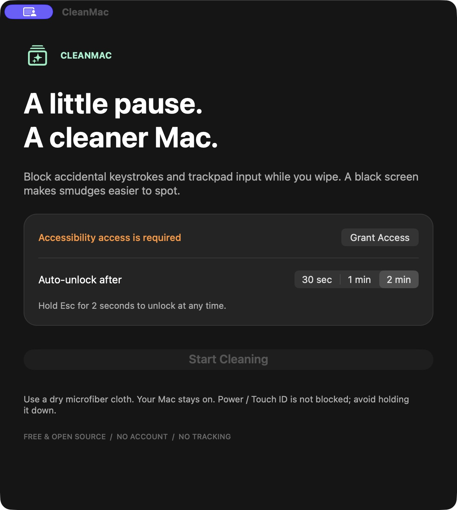

<div align="center">

# CleanMac

### A little pause. A cleaner Mac.

A free, open-source cleaning mode for macOS.\
Block accidental input. Make smudges easier to spot. Get back to work.

[](#requirements)
[](#build-from-source)
[](LICENSE)
[](https://github.com/KaridesFisher/CleanMac/actions/workflows/build.yml)

**[Download](https://github.com/KaridesFisher/CleanMac/releases/latest)** · **[Get started](#getting-started)** · **[Report a bug](https://github.com/KaridesFisher/CleanMac/issues/new)**



</div>

## Why CleanMac?

Wiping a MacBook keyboard can type random characters or trigger shortcuts. Shutting down may not solve it: a key press can turn the Mac back on. CleanMac gives you a short, deliberate cleaning break while your Mac stays awake.

It temporarily blocks keyboard, mouse, and trackpad events and covers connected displays with black windows. Hold **Esc for 2 seconds** to restore input, or let the session expire automatically.

| Feature | What you get |
| --- | --- |
| Input blocking | Suppresses common keyboard, pointer, button, scroll, and media-key events during a session. |
| Black display covers | Makes fingerprints visible without changing your brightness settings. |
| Three session lengths | Choose 30 seconds, 1 minute, or 2 minutes. |
| Hold to unlock | Esc progress appears as you hold the key. Releasing it resets the hold. |
| Automatic release | Every session is limited to a maximum of 2 minutes. |
| Native and lightweight | Swift + AppKit. No web runtime, package dependencies, account, or subscription. |
| Private by design | No analytics, ads, network requests, or keystroke logging. |

> **CleanMac is a physical cleaning helper, not a storage cleaner or security lock.** Your Mac stays powered on. The displays are covered in black; the hardware is not switched off.

## Requirements

- macOS Ventura 13 or later.
- Apple Silicon or Intel Mac. Release packages contain a universal binary.
- Accessibility permission, granted explicitly in System Settings.

Universal compilation is checked during builds. Hardware behavior still needs testing on each Mac/macOS combination; please report reproducible problems.

## Getting started

1. Download **CleanMac.zip** from [Releases](https://github.com/KaridesFisher/CleanMac/releases/latest).
2. Unzip it and move **CleanMac.app** into **Applications** before granting permissions.
3. Open CleanMac. Click **Grant Access**, then enable CleanMac under **System Settings → Privacy & Security → Accessibility**.
4. Return to the app, choose your session length, and click **Start Cleaning**.
5. Wipe gently with a **dry microfiber cloth**.
6. Hold **Esc continuously for 2 seconds** to unlock. You can also wait for the countdown to finish.

### First-launch warning

The published app is ad-hoc signed, **not signed with an Apple Developer ID or notarized by Apple**. macOS may block its first launch. Review the source and only proceed if you trust this project. On supported macOS versions, **System Settings → Privacy & Security → Open Anyway** is available after a blocked launch. You can also build the app yourself below.

### Updating from an earlier version

Quit CleanMac before replacing the app. Version 1.2 uses the bundle identifier `io.github.karidesfisher.cleanmac`. Older personal builds used `local.cleanmac.cleaner`; remove their obsolete Accessibility entries and grant access to the new app. Rebuilding or replacing an ad-hoc signed app can also require removing and re-adding its permission entry.

## Important limitations

- **Power / Touch ID is not blocked.** Avoid holding the power button down.
- Some macOS-reserved shortcuts and security dialogs can bypass input interception. This is not a substitute for locking your session.
- Black windows do not turn off display backlights or the computer. CleanMac does not change screen brightness or keyboard lighting.
- Accessibility restrictions or Secure Input in another app may prevent expected input interception. If the input tap is disabled, CleanMac ends the session instead of trying to keep it locked.
- Sleep, user-session changes, or display reconfiguration end an active session. A running, responsive app also auto-unlocks at the selected deadline; an app or OS hang can delay timers. Force Quit remains a fallback if macOS permits it.
- Use a dry cloth while the Mac is on. For damp cleaning, shut down and disconnect power instead. See [Apple's cleaning guidance](https://support.apple.com/en-us/103258).

## Troubleshooting

**Start Cleaning is disabled**  
Enable Accessibility access. The app refreshes permission status every second. Quit and reopen it if the status does not update.

**Input blocking cannot start after an update**  
Remove the previous CleanMac entry from Accessibility, add the current app from Applications, enable it, and restart the app.

**Esc does not unlock**  
Hold Esc without releasing it for the full two seconds. A progress percentage should appear. If it does not, wait for the selected timeout (at most two minutes). Include your Mac model, macOS version, and whether the progress appeared when filing an issue.

## Build from source

Install Apple's Command Line Tools (or Xcode), then:

```sh
git clone https://github.com/KaridesFisher/CleanMac.git
cd CleanMac
bash scripts/test.sh
bash scripts/build.sh
open dist/CleanMac.zip
```

The build script compiles **arm64 and x86_64** for macOS 13+, merges them into one universal app, ad-hoc signs it, verifies the signature, and creates:

```text
dist/CleanMac.zip
dist/SHA256SUMS.txt
```

To verify a downloaded archive, place the release's checksum file next to it and run:

```sh
shasum -a 256 -c SHA256SUMS.txt
```

`CLEANMAC_OUTPUT_DIR` and `CLEANMAC_MODULE_CACHE` can override the output and compiler cache directories. Builds need no third-party packages or network connection once Apple's tools are installed.

## How it works

A session-scoped Quartz event tap suppresses selected input events. Esc press/release events are processed directly inside that tap; autorepeat never resets the hold. A monotonic clock tracks both the hold and automatic timeout. Borderless AppKit windows cover each display, with a dim exit hint near the bottom.

Stopping a session invalidates the event tap and timer, removes the covers, and releases the activity that kept the display awake. The app stores only session timing and Esc's held state in memory, not typed text. Nothing is sent anywhere.

## Development

```text
Sources/        AppKit interface, input interception, and session logic
Tests/          Deterministic hold-to-exit and timeout regression tests
Resources/      App metadata (English only)
scripts/        Universal build, signing, packaging, and test commands
docs/           Interface preview and manual verification checklist
.github/        macOS build checks and tagged-release automation
```

Run `bash scripts/test.sh` before opening a pull request. The tests cover short holds, autorepeat, release/repress, timeout boundaries, duration bounds, and session resets. The macOS workflow runs these tests and builds the universal app. Physical keyboard/trackpad behavior and permission prompts require the [manual checks](docs/TESTING.md).

Contributions are welcome. See [CONTRIBUTING.md](CONTRIBUTING.md) for the workflow and [PRIVACY.md](PRIVACY.md) for data handling.

## License

[MIT](LICENSE) © 2026 [KaridesFisher](https://github.com/KaridesFisher).
